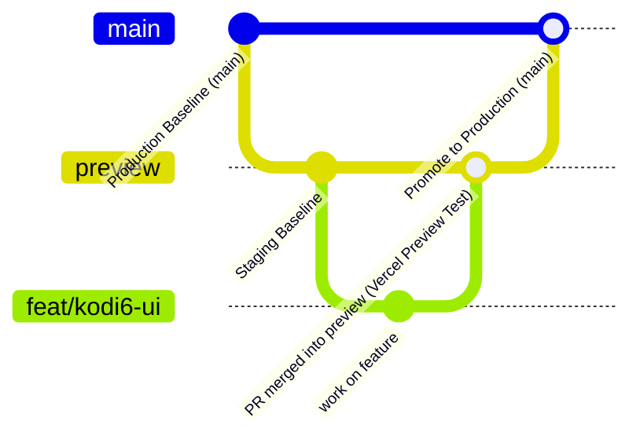

# 🚀 The Embrione & Kodikon Web Portal

Official web repository for **The Embrione** — the technical vertical under the Department of Computer Science and Engineering at **PES University, Bengaluru** — and the official platform for **Kodikon**, our flagship national-level 24-hour hackathon.

[](https://nextjs.org/)
[](https://tailwindcss.com/)
[](https://www.framer.com/motion/)
[](https://pes.edu/)
[](./LICENSE)

---

## 📌 Table of Contents

- [Overview](#-overview)
- [Tech Stack](#-tech-stack)
- [Project Architecture & Directory Structure](#-project-architecture--directory-structure)
- [Getting Started & Local Setup](#-getting-started--local-setup)
- [Environment Variables](#-environment-variables)
- [Key Features & Routes](#-key-features--routes)
- [How to Update Content](#-how-to-update-content)
- [Collaboration & Preview Workflow](#-collaboration--preview-workflow)
- [Domain & Deployment Setup (Vercel & DNS)](#-domain--deployment-setup-vercel--dns)
- [Troubleshooting & FAQs](#-troubleshooting--faqs)
- [License](#-license)

---

## 🌐 Overview

This application serves multiple primary functions:
1. **Club Hub (`/`)**: A modern Apple-inspired redesign showcasing Embrione's mission, department heritage, domain leadership with interactive 3D cards, past hackathon archives with full-screen lightboxes, industry partners, and community recruitment.
2. **Kodikon 6.0 Flagship Hackathon (`/kodikon-6` & `/kodi-6`)**: The preview and early-access notification portal for the upcoming 24-hour national hackathon at PESU 52, PES University, featuring curriculum-aligned research tracks, venue specifications, FAQ clarifications, and pre-registration.
3. **Kodikon 5.0 Portal & Archives (`/kodikon-5`, `/kodikon-4`, `/kodikon-3`)**: The complete historical portals for previous editions with research themes, sponsor showcases, roadmaps, and prize galleries.
4. **Legacy Club Portal (`/old`)**: The preserved original cyberpunk-themed club portal.

---

## 🛠 Tech Stack

- **Framework**: [Next.js 13.5](https://nextjs.org/) (Hybrid App Router + Pages API)
- **Styling**: [Tailwind CSS](https://tailwindcss.com/) with custom dark palette, cyan glows, and responsive typography
- **Animations & Interactivity**:
  - [Framer Motion](https://www.framer.com/motion/) for fluid page entries and transitions
  - [Lottie React](https://github.com/Gamote/lottie-react) for vector animations
  - [use-scramble](https://use-scramble.vercel.app/) for terminal text effects
  - [AOS (Animate On Scroll)](https://michalsnik.github.io/aos/)
  - [Swiper](https://swiperjs.com/) for touch-friendly event photo carousels
- **Icons**: [Lucide React](https://lucide.dev/) & [React Icons](https://react-icons.github.io/react-icons/)
- **SEO & Schema**: Schema.org JSON-LD (EducationalOrganization, Hackathon, WebSite), dynamic XML sitemap, robots.txt, and OpenGraph assets

---

## 📂 Project Architecture & Directory Structure

All components are strictly modularized into dedicated folders under `components/` with decoupled dataset files to minimize merge conflicts during concurrent development:

```text
kodi5-website/
├── app/                                # Next.js App Router
│   ├── layout.js                       # Root layout (fonts, SEO metadata, Schema.org)
│   ├── globals.css                     # Global styles, scrollbar styling, animations
│   ├── page.js                         # Redesigned Embrione Club Landing Page
│   ├── kodikon-6/                      # Kodikon 6.0 Flagship Hackathon Page
│   │   └── page.js
│   ├── kodi-6/                         # Kodikon 6.0 Shortcut Route
│   │   └── page.js
│   ├── kodikon-5/                      # Kodikon 5.0 Landing Page
│   │   ├── page.js
│   │   └── layout.js
│   ├── kodikon-4/                      # Kodikon 4.0 Archive Page
│   ├── kodikon-3/                      # Kodikon 3.0 Archive Page
│   ├── old/                            # Legacy Club Portal Archive
│   ├── privacy-policy/                 # Privacy Policy
│   ├── terms/                          # Terms of Service
│   ├── sitemap.js                      # Dynamic XML Sitemap Generator
│   ├── robots.js                       # Search Engine Crawling Directives
│   └── manifest.js                     # Web App Manifest
│
├── components/                         # Modular React components & decoupled datasets
│   ├── HomeRedesign/                   # Redesigned homepage sections
│   │   ├── NavbarHome.jsx              # Frosted glass responsive navbar
│   │   ├── HeroSection.jsx             # Hero with dynamic statistics & CTAs
│   │   ├── AboutSection.jsx            # Club mission & CSE department pillar
│   │   ├── KodikonSpotlight.jsx        # Past editions spotlight & photo lightbox
│   │   ├── TeamSection.jsx             # Domain leadership tabs & card layout
│   │   ├── TeamCard3D.jsx              # 3D interactive member card with tilt
│   │   ├── PartnersSection.jsx         # Industry partners grid
│   │   ├── CTASection.jsx              # Engagement & recruitment banner
│   │   ├── FooterHome.jsx              # Footer with campus details & links
│   │   ├── pastHeadsData.js            # Decoupled past heads & role definitions
│   │   └── partnersData.js             # Decoupled partner & sponsor list
│   │
│   ├── Kodikon-6/                      # Kodikon 6.0 modular components
│   │   ├── NavbarKodikon6.jsx          # Header with home return & registration CTA
│   │   ├── HeroComponent.jsx           # Hero banner & event facts (Duration, Venue, Team)
│   │   ├── TracksComponent.jsx         # Technical tracks cards layout
│   │   ├── tracksData.js               # Decoupled tracks data & descriptors
│   │   ├── InterestFormComponent.jsx   # Interactive pre-registration notification form
│   │   ├── FAQComponent.jsx            # Kodikon 6.0 Q&A grid
│   │   ├── FAQData.js                  # Decoupled FAQ questions & answers
│   │   ├── FooterKodikon6.jsx          # Edition footer & legal links
│   │   ├── StructuredData.jsx          # Schema.org Hackathon JSON-LD
│   │   └── index.js                    # Barrel exports
│   │
│   ├── Kodikon-5/                      # Kodikon 5.0 components
│   │   ├── NavbarKodikon5.jsx          # Hackathon sticky navbar
│   │   ├── HeroComponent.jsx           # Matrix rain effect + title sponsor
│   │   ├── AboutTheEvent/              # Event narrative & stats
│   │   ├── Countdown/                  # Dynamic registration countdown
│   │   ├── HackathonThemes/            # 3 research tracks + detail popups
│   │   ├── Timeline/                   # 5-stage interactive vertical roadmap
│   │   ├── Sponsors/                   # Pixcellence title sponsor showcase
│   │   ├── Partners/                   # Hack2Skill partner section
│   │   ├── Prizes/                     # First, second, third prize badges
│   │   ├── FAQComponent.jsx            # Hackathon Q&A accordions
│   │   ├── MapComponent.jsx            # PES Dr. MRD Block embed & directions
│   │   └── FAQData.js                  # FAQ content source
│   │
│   ├── Kodikon-4/                      # Kodikon 4.0 components
│   ├── Kodikon-3/                      # Kodikon 3.0 components
│   └── [Legacy Components]             # AboutUs, Announcements, ContactUs, Hero, etc.
│
├── pages/api/                          # Next.js Pages API Routes
│   ├── sendMessage.js                  # Contact form email delivery via Nodemailer
│   └── getTime.js                      # Server-synchronized countdown timestamp
│
├── public/                             # Public static assets
│   ├── 2025-domain-heads/              # Current domain head & core headshots
│   ├── current-domain-heads/           # 2024 domain head photos archive
│   ├── domiainHeadPhotos/              # 2023 domain head photos archive
│   ├── Kodikon5/                       # Theme thumbnails, logos, prize images
│   ├── Kodikon4/                       # Kodikon 4.0 graphics & assets
│   ├── Kodikon3/                       # Kodikon 3.0 graphics & assets
│   └── sponsors/                       # Sponsor logos (Tech, Food, Travel)
│
├── constants.js                        # Master data file (Current Team, Events, Socials)
├── tailwind.config.js                  # Tailwind theme, typography & keyframes
├── LICENSE                             # MIT License
└── package.json                        # Dependencies and npm scripts
```

---

## ⚡ Getting Started & Local Setup

### 1. Prerequisites
- **Node.js**: `v18.x` or higher installed ([Download](https://nodejs.org/))
- **Package Manager**: `npm`, `yarn`, or `pnpm`
- **Git**: Installed and configured

### 2. Clone & Install
```bash
# Clone the repository
git clone https://github.com/The-Embrione-Website/embrione-pes.git
cd kodi5-website

# Install dependencies (use --legacy-peer-deps for dependency resolution)
npm install --legacy-peer-deps
```

### 3. Setup Environment Variables
Create a local `.env.local` file:
```bash
cp .env.example .env.local
```
Add your credentials if testing email relays (see [Environment Variables](#-environment-variables)).

### 4. Run Development Server
```bash
npm run dev
```
Open [http://localhost:3000](http://localhost:3000) in your browser.
- Homepage: [http://localhost:3000/](http://localhost:3000/)
- Kodikon 6.0: [http://localhost:3000/kodikon-6](http://localhost:3000/kodikon-6)
- Kodikon 5.0: [http://localhost:3000/kodikon-5](http://localhost:3000/kodikon-5)
- Legacy Portal: [http://localhost:3000/old](http://localhost:3000/old)

### 5. Production Build Verification
```bash
npm run build
npm run start
```

---

## 🔑 Environment Variables

The application supports the following environment variables in `.env.local`:

| Variable | Description | Required For |
|---|---|---|
| `APP_PASSWORD` | Google App Password for `theembrionetech@gmail.com` | Contact form submission via `/api/sendMessage` |

> [!NOTE]
> If testing the frontend without sending live emails, `APP_PASSWORD` can be omitted, but `/api/sendMessage` will fail with an authentication error on form submit.

---

## 🗺 Key Features & Routes

| Route | Description | Primary Components |
|---|---|---|
| `/` | Modern Redesigned Club Portal | `NavbarHome`, `HeroSection`, `AboutSection`, `KodikonSpotlight`, `TeamSection`, `PartnersSection`, `CTASection`, `FooterHome` |
| `/kodikon-6` | Kodikon 6.0 Flagship Hackathon Preview | `NavbarKodikon6`, `HeroComponent`, `TracksComponent`, `InterestFormComponent`, `FAQComponent`, `FooterKodikon6`, `StructuredData` |
| `/kodi-6` | Shorthand vanity URL | 308 permanent redirect to `/kodikon-6` |

| `/kodikon-5` | Kodikon 5.0 Hackathon Portal | `HeroComponent`, `AboutTheEvent`, `HackathonThemes`, `EventTimeline`, `Sponsors`, `Partners`, `Prizes`, `FAQ`, `Map` |
| `/kodikon-4` | Kodikon 4.0 Archive | `Kodikon-4/*` |
| `/kodikon-3` | Kodikon 3.0 Archive | `Kodikon-3/*` |
| `/old` | Legacy Club Portal Archive | Legacy components (`Hero`, `AboutUs`, `Team`, `PastEvents`, etc.) |
| `/privacy-policy` | Privacy Policy Page | Static legal policy document |
| `/terms` | Terms of Service Page | Static legal terms document |
| `/api/sendMessage` | Contact API route | Handles contact form POST submissions |
| `/api/getTime` | Countdown sync API | Returns synchronized timestamp for countdown timers |

---

## ✏️ How to Update Content

Data is decoupled from presentation components to ensure team members can update event details and rosters with minimal risk of merge conflicts.

### 👥 Updating Current 2025 Team Members
Edit `constants.js` under the `teamMembersDetails` array:
```javascript
{
  name: "Full Name",
  domain: "Web Development", // WebDev, Event Management, Sponsorship, Design, Operations, Logistics, Hospitality, Social Media
  role: "Head",              // "Head" or "Core"
  photoUrl: "/2025-domain-heads/YourPhoto.webp", // Place image in public/2025-domain-heads/
  linkedinUrl: "https://www.linkedin.com/in/username/",
  email: "your.email@example.com",
}
```

### 🏛 Updating Past Heads & Upcoming 2026 Roles
Edit `components/HomeRedesign/pastHeadsData.js`:
- Update `pastHeads2024`, `pastHeads2023`, or `upcoming2026Roles` without touching `TeamSection.jsx`.

### 🤝 Updating Industry Partners
Edit `components/HomeRedesign/partnersData.js`:
- Add or update partner names, categories, and logos in the `partnersData` array.

### ⚡ Updating Kodikon 6.0 Tracks
Edit `components/Kodikon-6/tracksData.js`:
- Modify track codes (`TRACK-01`, etc.), titles, Lucide icons, and descriptions without modifying the layout component.

### ❓ Updating Kodikon 6.0 FAQs
Edit `components/Kodikon-6/FAQData.js`:
- Add or modify questions and answers in `Kodikon6FAQData`.

### 🎯 Updating Kodikon 5.0 Themes, Timeline & FAQs
- **Themes**: Edit `components/Kodikon-5/HackathonThemes/HackathonThemes.jsx`
- **Timeline**: Edit `components/Kodikon-5/Timeline/EventTimelineComponent.jsx`
- **FAQs**: Edit `components/Kodikon-5/FAQData.js`

---

## 🌿 Collaboration & Preview Workflow

To allow everyone to test features in real-time with **Vercel Previews** without breaking production, we follow a two-tier branching strategy:

- **`main`**: The **Production** branch. Only verified, release-ready code is merged here.
- **`preview`**: The **Staging / Preview** branch. Every PR targeting `preview` automatically gets a live, shareable Vercel Preview URL.



### Step-by-Step Contribution Workflow

#### 1. Always branch off `preview`
```bash
# Switch to preview and pull the latest changes
git checkout preview
git pull origin preview

# Create your descriptive feature branch
git checkout -b feat/your-feature-name      # e.g. feat/kodi6-tracks
# or: git checkout -b fix/navbar-bug
```

#### 2. Commit Standards
Write clear, conventional commit messages:
```bash
git commit -m "feat: add interactive track popup for AI theme"
git commit -m "fix: correct registration countdown timezone"
git commit -m "style: refine footer padding on mobile screens"
```

#### 3. Push and Open a Pull Request targeting `preview`
```bash
git push -u origin feat/your-feature-name
```
On GitHub:
- Set **Base branch**: `preview`
- Set **Compare branch**: `feat/your-feature-name`

#### 4. Test the Live Vercel Preview
- Once the PR is opened, the Vercel GitHub bot will post a comment with a unique **Preview Deployment URL** (e.g. `https://embrione-pes-git-feat-your-feature-...vercel.app`).
- Test your changes directly on mobile and desktop using that link!

#### 5. Merge into `preview` ➔ Promote to `main`
- After code review, merge your PR into `preview`.
- Once all staging features on `preview` are verified, a designated lead will open a PR from `preview` into `main` to deploy to production.

---

## 🌐 Domain & Deployment Setup (Vercel & DNS)

If you are connecting custom domains (`embrionepes.in` or `www.embrionepes.in`):

### 1. Vercel Configuration
1. Open your project on the [Vercel Dashboard](https://vercel.com/).
2. Navigate to **Settings** ➔ **Domains**.
3. Add both:
   - `embrionepes.in`
   - `www.embrionepes.in`

### 2. Registrar (GoDaddy / Hostinger / BigRock) DNS Records
Ensure your registrar's DNS records point to Vercel instead of parking servers:

| Record Type | Name / Host | Target / Points To | Purpose |
|---|---|---|---|
| **A** | `@` | `76.76.21.21` | Direct apex domain to Vercel |
| **CNAME** | `www` | `cname.vercel-dns.com` | Direct www subdomain to Vercel |

---

## ❓ Troubleshooting & FAQs

### Q: Why does the domain redirect to `/lander`?
**A:** This happens when the domain registrar (e.g. GoDaddy) has the domain parked. It means either:
1. The domain registration expired and needs renewal at the registrar.
2. The DNS `A` record is still set to GoDaddy's default parking IP (`13.248.213.45`) instead of Vercel's IP (`76.76.21.21`).
*Note: Your local site (`npm run dev`) and Vercel preview links will work normally.*

### Q: `npm install` throws peer dependency warnings?
**A:** Use the `--legacy-peer-deps` flag:
```bash
npm install --legacy-peer-deps
```

### Q: How do I verify my build before pushing?
**A:** Always run:
```bash
npm run build
```
Ensure all routes compile successfully with `✓ Generating static pages (18/18)` before opening a PR.


---

## 📄 License

This project is licensed under the [MIT License](./LICENSE) &copy; 2025-2026 The Embrione, PES University.

---

<p align="center">Made with ♥ by <b>The Embrione WebDev Team</b></p>
